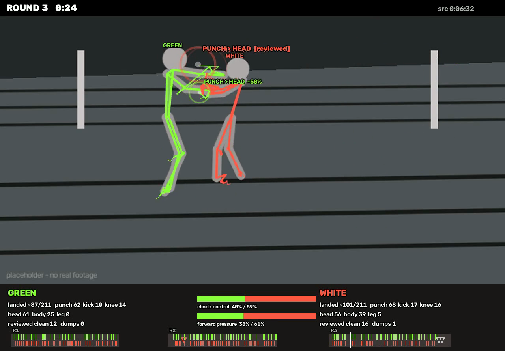
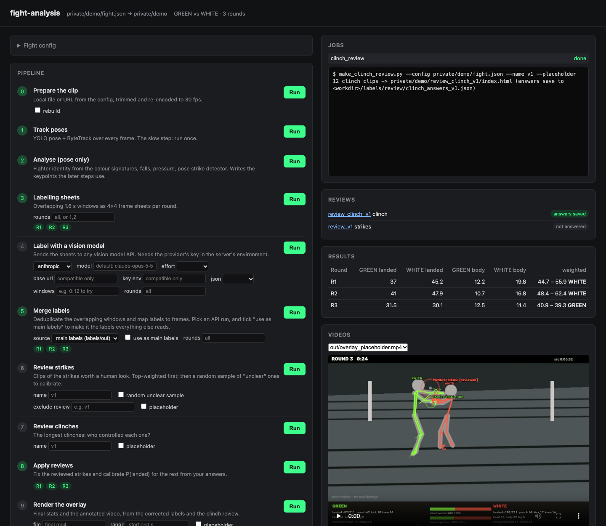
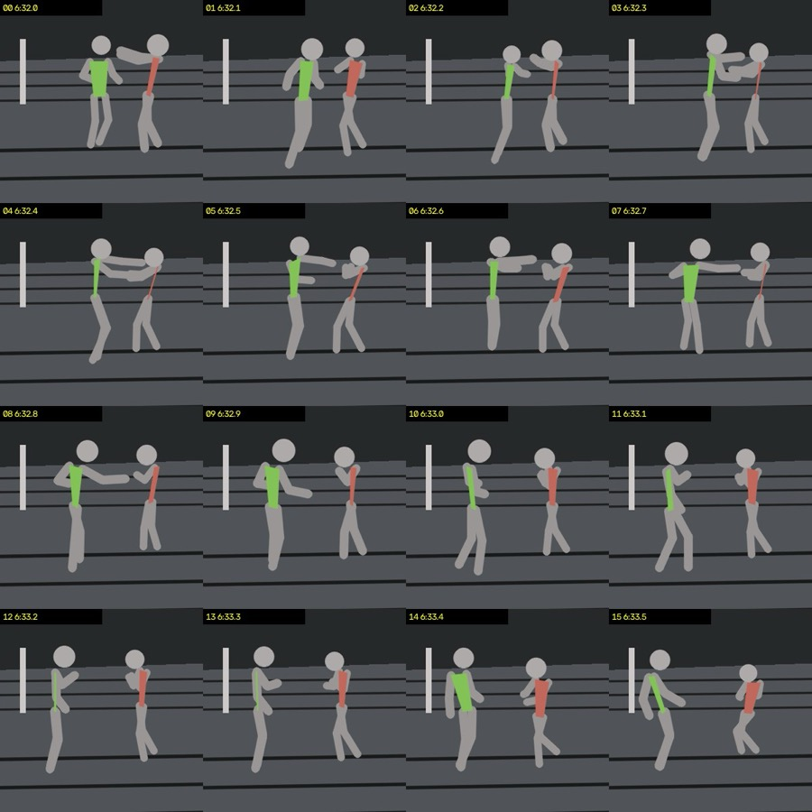
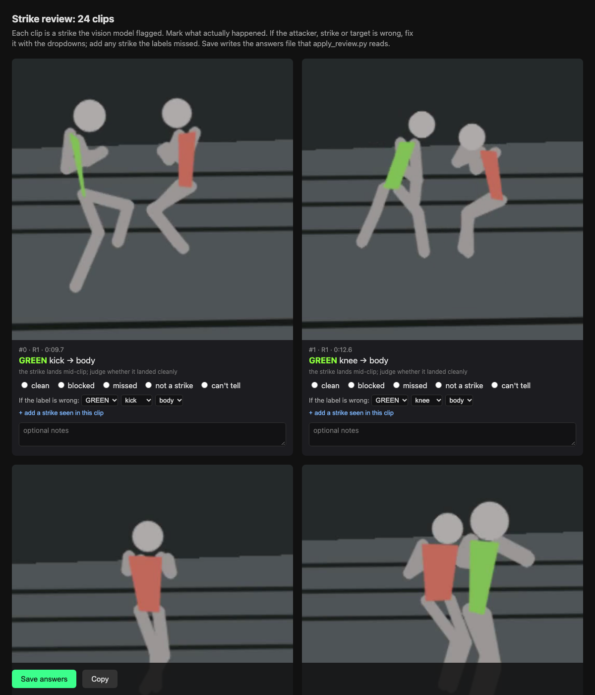
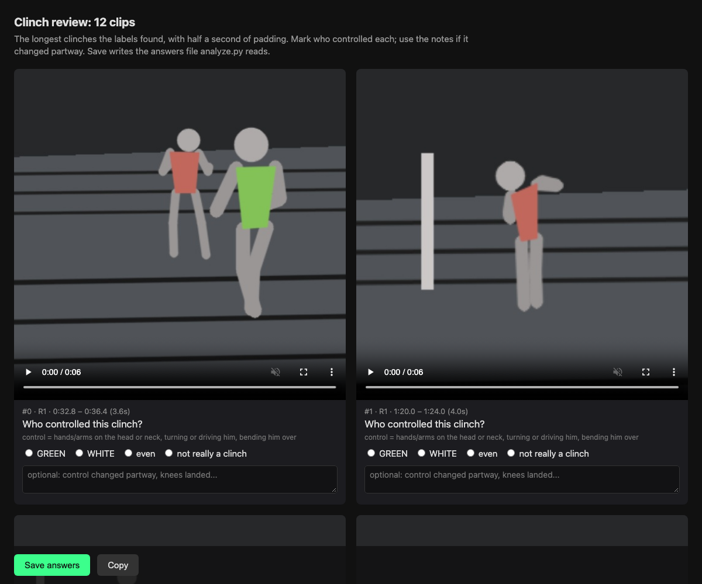

# fight-analysis

Scores a combat-sports bout from a single fixed-camera video. It was built for Muay Thai.
The pipeline combines pose tracking, strike labelling by a vision model, and a short human
review that corrects and calibrates the labels. The output is per-round stats and an
annotated overlay video.


<sub>Rendered in placeholder mode: the real tracked skeletons drawn as mannequins on a drawn ring.
On a real run the overlay is drawn on the footage.</sub>

## What footage it expects

- **One fixed camera, elevated:** roughly three-quarters of the way up, looking down across the ring
  from one side. Think a phone held up at ringside or on a balcony. The camera can pan to follow the
  action, and it's compensated for. Several angles or broadcast cuts aren't supported.
- **One bout, two fighters you can tell apart by clothing:** shorts, tops, shin guards. The config
  describes each fighter as colour ranges.
- **Low resolution is fine:** 360p works. Better footage mainly improves the clean-vs-blocked calls.
- **Any source:** a local file, or any URL `yt-dlp` can download, optionally trimmed to the bout.

## How it works

1. **Prepare** (`prepare_video.py`): cut the bout out of the source and re-encode it to 30 fps.
2. **Track** (`track.py`): YOLO11-pose + ByteTrack give 17 keypoints for everyone in every frame.
   This is the only slow step (about 15 minutes for 9 minutes of video on an M3).
3. **Analyse** (`analyze.py`):
   - picks out the two fighters each frame, using their colour signatures, apparent size,
     tracker-ID continuity and how far they've moved
   - corrects for camera panning
   - detects falls, including fighters who drop out of view on the canvas and come back crouched
   - measures forward pressure and clinch time and control
   - adds up per-round stats and renders the overlay
4. **Label** (`make_strips.py` → `label_strips.py` → `merge_labels.py`): every round is cut into
   overlapping 1.6 s windows, each rendered as a 4×4 sheet of frames. Any vision model then labels
   every strike attempt in them: attacker, strike, target and outcome. Overlapping windows are
   deduplicated afterwards.
5. **Review** (`make_review.py`, `make_clinch_review.py`): short slowed-down clips of the strikes
   and clinches that matter. A person marks what happened, and the answers are saved to files.
6. **Calibrate** (`apply_review.py`): reviewed strikes are fixed. Every other strike gets a
   probability of having landed, learned from how often the model's "clean", "unclear" and
   "blocked" calls held up for each fighter.
7. **Render** (`analyze.py --labels … --clinch-review …`): the final stats and overlay video.

Why so many stages? On a 9-minute amateur bout filmed on a phone at 360p:
- **Pose geometry alone** couldn't tell a landed punch from a glove in front of the face. From one
  camera, two fighters standing one behind the other "touch" everywhere. It also missed about half
  of real strikes, body shots most of all.
- **A vision model** found far more strike attempts, but its clean-vs-blocked calls matched a human
  only 13 of 24 times. It systematically misread one fighter's kicks as punches, and its
  clinch-control calls matched only 2 of 9.
- **48 reviewed strikes and 12 reviewed clinches** were enough to correct the bias and calibrate
  the rest.

## Quick start

```bash
uv sync --extra label                     # pose model + the vision-model SDKs (anthropic, openai)
cp configs/example.fight.json private/fight.json
# edit private/fight.json: video source/start/end, camera, fighters (see below)
uv run python web/server.py               # http://127.0.0.1:8765
```



The UI runs each stage as a background job, queued in order with a live log. It opens the review
pages, and their **Save answers** button writes straight into the fight's folder. It also shows the
per-round results and the rendered videos. Everything binds to localhost.

The same steps from the command line (each script reads `private/fight.json`, or `--config` /
`$FIGHT_CONFIG`; `<workdir>` is the config's `workdir`):

```bash
uv run python prepare_video.py
uv run python track.py
uv run python analyze.py --no-render                # pose-only pass; writes the keypoints the rest uses
uv run python make_strips.py --round 1              # ...for each round
uv run python label_strips.py --round 1 --dry-run   # check the prompt and request count
uv run python label_strips.py --round 1             # Claude by default; see "Labelling" for other models
uv run python merge_labels.py --round 1 --labels-dir <workdir>/labels/api/<run> --promote
uv run python make_review.py --name v1              # top-weighted strikes
uv run python make_review.py --name v2 --random --outcome unclear --exclude <workdir>/review_v1/items.json
uv run python make_clinch_review.py --name v1
# answer the review pages (open <workdir>/review_v1/index.html, or use the UI), then:
uv run python apply_review.py --review <workdir>/review_v1:<workdir>/labels/review/answers_v1.json \
                                       <workdir>/review_v2:<workdir>/labels/review/answers_v2.json
uv run python analyze.py --labels <workdir>/labels/r{1,2,3}_events_corrected.json \
  --clinch-review <workdir>/review_clinch_v1:<workdir>/labels/review/clinch_answers_v1.json \
  --out <workdir>/out/final.mp4
```

Add `--placeholder` to `analyze.py`, `make_strips.py`, `make_review.py` or `make_clinch_review.py`
to draw mannequins instead of real footage, for sharing or demos.

## The fight config

Everything specific to one video and bout lives in one JSON file
([`configs/example.fight.json`](configs/example.fight.json)). The code itself has no fight-specific values.

| Field | What it is |
|---|---|
| `workdir` | Where this fight's clip, tracks, labels, reviews and renders go. Keep it under `private/`, which is git-ignored. |
| `video.source` | A local path or URL. `video.start` / `video.end` (e.g. `"0:42:10"`) trim it. |
| `video.timecode_offset` | The source time shown for the clip's first frame. Defaults to `start`, so timestamps match the source. |
| `camera` | A sentence describing the framing. It goes into the labelling prompt. |
| `rounds` | `[[start, end], ...]` in seconds of the *prepared clip*. Scrub the clip to find them. |
| `fighters[]` | Exactly two. `id` (used everywhere, e.g. `RED`), a `description` for the labelling prompt, and `draw_bgr` (overlay colour). `torso` / `legs` are lists of OpenCV HSV ranges (`h` 0–179, `s` and `v` 0–255) matched against the upper body and lower legs (e.g. shin guards). An optional `weights` (`torso`, `legs`, `other_torso`) controls how identity is scored. |
| `ignore` | Who the labeller should ignore: referee, corners, spectators, other rings. |
| `official_result` | Optional. Shown on the final card for comparison. |

Tip for colour ranges: the analysis caches colour features per signature, so it's cheap to iterate.
Check identity with `debug_strikes.py`, or render a short `--range`.

## Labelling with any vision model

`label_strips.py` sends a few windows per request and gets back JSON that matches a fixed schema.
The fighter IDs come from the config.

| `--provider` | Uses | Key |
|---|---|---|
| `anthropic` (default) | official `anthropic` SDK. JSON-schema output, `--effort`, and if Claude declines a request on safety grounds the API retries it on a fallback model (`--no-fallback` turns that off) | `ANTHROPIC_API_KEY` or `ant auth login` |
| `openai`, `gemini`, `openrouter` | `openai` SDK against that provider's OpenAI-compatible endpoint | `OPENAI_API_KEY` / `GEMINI_API_KEY` / `OPENROUTER_API_KEY` |
| `ollama` | a local model | none |
| `compatible` | any OpenAI-compatible server: `--base-url`, `--api-key-env` | yours |

`--json-mode object|prompt` is for servers without strict JSON schema. Runs can be resumed
(per-round JSONL under `<workdir>/labels/api/<run>/`), and they never overwrite reviewed labels
unless you `merge_labels.py --promote`.

Cost: each sheet is about 2K image tokens on Claude, and a 9-minute bout is about 320 windows, so
roughly 110 requests at `--batch 3`. On Claude Opus 5.5 at `--effort high` that's on the order of
ten dollars. Try `--windows 0:12` on one round first.


<sub>One labelling window (placeholder mode): 16 frames at 0.1 s intervals, each tile stamped with its index and source time.</sub>

## Reviewing



For each clip: the outcome (clean / blocked / missed / not a strike / can't tell), corrected
attacker, strike or target if the label is wrong, and any strikes the labels missed. Answers are
saved as `<workdir>/labels/review/answers_<name>.json`:

```json
[{"id": 3, "outcome": "clean", "kind": "kick", "target": "leg",
  "add": [{"dt": 0.5, "by": "RED", "kind": "punch", "target": "head", "outcome": "clean"}],
  "note": "leg kick, not a punch; counter right hand lands"}]
```

Two rounds of about 24 clips work well. The first is **top-weighted**: the strikes that matter
most. The second is a **random sample of "unclear" labels**, so the landing rate learned from it
carries over to the rest.



Clinch control comes from the review only. Pose tracking merges two fighters locked in a clinch,
and in our test the model's control calls were close to random.

## Repository layout

- **Scripts:** `prepare_video.py`, `track.py`, `analyze.py`, `make_strips.py`, `label_strips.py`,
  `merge_labels.py`, `make_review.py`, `make_clinch_review.py`, `apply_review.py`, `debug_strikes.py`
- **Shared modules:**
  - `fightconfig.py`: config loading
  - `review_ui.py`: review clips and pages
  - `placeholder.py`: the mannequin renderer
- **`web/`:** the pipeline UI (stdlib HTTP server + one HTML page)
- **`tests/test_label_strips.py`:** both labelling backends checked against a local fake API server
  (no key, no network)
- **`configs/`:** example fight config
- **`private/`:** git-ignored. Fight data, labels, reviews and renders.

## Known limits

- **Clean vs blocked:** from one low-resolution angle this often isn't in the pixels. That's what the
  review and calibration are for, and they rest on one reviewer's eye unless several people review.
- **Type and target errors:** the model's mistakes there are only fixed on strikes someone reviewed.
- **Clinch timing:** clinch boundaries come from labeller notes and are accurate to about a second.
- **Fighter IDs in clinches:** they can swap when the two fighters overlap. Colour signatures plus
  tracker continuity keep this rare but not impossible.
